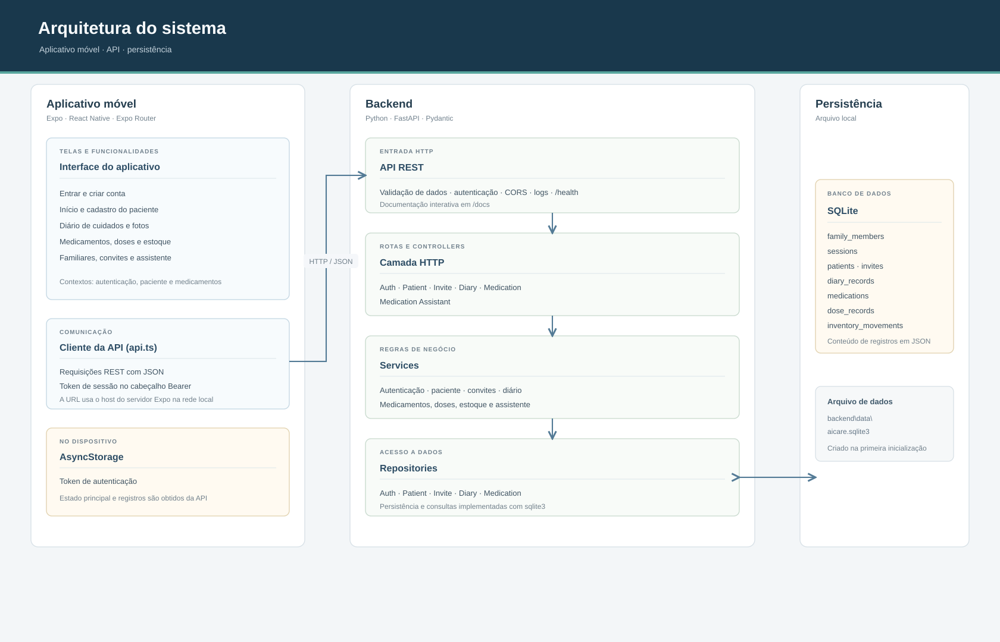

# AICARE – PROJETO DE APLICATIVO MOBILE PARA O APOIO AO CUIDADO DE PESSOAS IDOSAS E AO GERENCIAMENTO DE MEDICAMENTOS

## Sobre o projeto

O AICare é um aplicativo móvel para apoiar familiares no cuidado diário de
pessoas idosas que precisam de acompanhamento. Ele reúne informações do paciente,
medicamentos e horários, registro de doses e diário de cuidados em um só lugar.
Também oferece recursos para compartilhar o acompanhamento com familiares e
auxiliar no cadastro de medicamentos.

O projeto resolve a dificuldade de manter essas informações organizadas e
acessíveis entre as pessoas envolvidas no cuidado, ajudando a acompanhar a
rotina e a manter um histórico. O frontend é feito com React Native e Expo; o
backend fornece uma API FastAPI e armazena os dados localmente em SQLite.

## Arquitetura



## Pré-requisitos

- Windows com PowerShell e Git.
- Python 3 e Node.js com npm instalados e disponíveis no terminal. Node.js 22
  LTS é recomendado.
- Expo Go instalado no celular.
- Computador e celular conectados à mesma rede Wi-Fi.

## Clonar e preparar o projeto

Abra o PowerShell e execute:

```powershell
git clone https://github.com/rcmafra/AICare.git
```

Dentro do workspace AICare, crie o ambiente Python do backend e instale suas dependências:

```powershell
python -m venv backend\.venv
backend\.venv\Scripts\python.exe -m pip install -r backend\src\requirements.txt
```

Instale as dependências do frontend:

```powershell
cd .\frontend
npm ci
```

## Iniciar a aplicação

Na raiz do projeto, execute:

```powershell
cd ..
.\start-dev.ps1
```

O script inicia a API em `http://localhost:8000` e, quando ela estiver pronta,
inicia o Expo. Se ainda não houver uma conta Expo autenticada, o script solicita
o login no terminal sem abrir o navegador; caso já esteja autenticado, segue
direto para a inicialização. Leia o QR code exibido com o Expo Go. O firewall
do Windows precisa permitir as conexões do celular às portas da API (`8000`) e
do Metro (normalmente `8081`).

Pressione `Ctrl+C` no terminal para encerrar o Expo e o backend. Os dados ficam
salvos em `backend\data\aicare.sqlite3` e permanecem entre inicializações.

Para escolher a porta inicial do Expo:

```powershell
.\start-dev.ps1 -ExpoPort 8090
```

O script escolhe a próxima porta livre para o Metro se a porta solicitada
estiver ocupada. A porta da API é fixa (`8000`); se estiver ocupada, encerre o
processo que a utiliza antes de iniciar o projeto.

A documentação interativa da API fica disponível em
`http://localhost:8000/docs` enquanto o backend estiver em execução.
